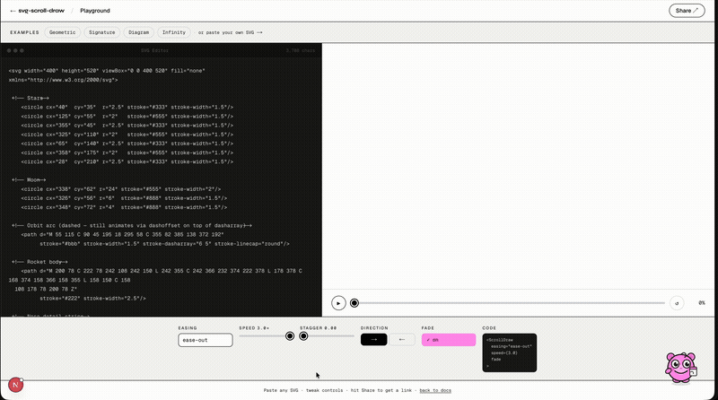

# svg-scroll-draw

[](https://www.npmjs.com/package/svg-scroll-draw)
[](https://www.npmjs.com/package/svg-scroll-draw)
[](https://bundlephobia.com/package/svg-scroll-draw)
[](./LICENSE)
[](https://github.com/DhruvilChauahan0210/ink-scroll/stargazers)

> Scroll-driven animation for the web. Draw SVG paths, reveal elements, pin sections, scrub video. Zero dependencies. Native CSS fast path on modern browsers.

**[Live Demo](https://svg-scroll-draw.vercel.app)** · **[23 Examples](https://svg-scroll-draw.vercel.app/examples)** · **[Blocks](https://svg-scroll-draw.vercel.app/blocks)** · **[Docs](https://svg-scroll-draw.vercel.app/docs)** · **[⚡ Playground](https://svg-scroll-draw.vercel.app/playground)** · [npm](https://www.npmjs.com/package/svg-scroll-draw)



**Try it in your browser, no install:** [Vanilla JS on StackBlitz](https://stackblitz.com/github/DhruvilChauahan0210/ink-scroll/tree/main/examples/vanilla) · [React on StackBlitz](https://stackblitz.com/github/DhruvilChauahan0210/ink-scroll/tree/main/examples/react)

**Using an AI coding agent?** Give it the [svg-scroll-draw skill](skills/svg-scroll-draw/SKILL.md) or point it at [llms.txt](https://svg-scroll-draw.vercel.app/llms.txt).

Works in **React · Next.js · Vue 3 · Svelte · Solid · Angular · Nuxt · Astro · CDN / vanilla JS** — a single tiny package with first-class wrappers for every major framework.

---

## Features at a glance

- **11.4 KB gzipped** for the whole main entry — and you rarely need all of it. Every API is a separate entry point: `scrollReveal` is 5.5 KB, `scrollPin` 1.6 KB, `scrollSnap` 1.9 KB. [Full size table below](#bundle-sizes), measured by `npm run size` and enforced in CI.
- **Native CSS fast path** — where the browser supports scroll-driven animations the draw runs on a CSS `view-timeline` with zero per-frame JavaScript, and falls back to the JS engine automatically everywhere else. Both engines are [verified to produce the same output](#native-css-rendering) by a cross-browser test suite rather than assumed to.
- **Zero dependencies** — no GSAP, no ScrollTrigger, no heavyweight runtime
- **vivus drop-in** — `import Vivus from 'svg-scroll-draw/vivus'` keeps your `new Vivus()` code; SVG output matched exactly against vivus 0.4.6. [Details](#vivus-drop-in--keep-your-new-vivus-code)
- **ScrollReveal drop-in** — `import ScrollReveal from 'svg-scroll-draw/scrollreveal'`: the same API under MIT instead of GPL-3.0, inline styles matched byte for byte against ScrollReveal 4.0.9. [Details](#scrollreveal-drop-in--mit-instead-of-gpl)
- **AOS drop-in** — `import AOS from 'svg-scroll-draw/aos'` runs your existing `data-aos` markup with no `aos.css`; tested side by side against AOS 2.3.4. [Details](#aos-drop-in--switch-from-aos-in-one-line)
- **Full playback API** — `pause`, `resume`, `seek`, `replay`, `getProgress`, `destroy`
- **Presets** — `{ preset: 'reveal' }` for instant one-liner setup; five named presets: `sketch`, `reveal`, `typewriter`, `cinematic`, `spring`
- **CLI** — `npx svg-scroll-draw init` generates a starter file for your framework; `npx svg-scroll-draw migrate` switches a project from AOS, ScrollReveal or vivus to the drop-ins in one command
- **30+ options** — easing, stagger, fade, stroke color/width lerp, fill opacity, clip reveal, morphTo, velocityScale, waypoints, callbacks, repeat, autoReverse, and more
- **Group / Sequence / Timeline APIs** — animate multiple containers simultaneously, one-after-another, or on independent scroll windows with `loop` for auto-looping after scroll completion
- **CSS custom property** — `--scroll-draw-progress` is set on every frame so you can drive any CSS animation without a callback
- **695 tests across 36 suites** — engine, options, native fast path, group, timeline, framework wrappers, cinematic, and each v2 API
- **230 browser tests on top of those**, run against Chromium, Firefox and WebKit in CI. The unit suite runs in jsdom, where `getTotalLength` is stubbed and `IntersectionObserver` is faked — it can check the engine's arithmetic but nothing about real browser behaviour. Both counts are derived from the suites themselves and enforced in CI, so neither can quietly drift out of date

---

## Table of contents

- [Install](#install)
- [Why this exists](#why-this-exists)
- [Quick start](#quick-start)
- [Native CSS rendering](#native-css-rendering)
- [Options](#options)
- [Instance methods](#instance-methods)
- [CSS custom property](#css-custom-property)
- [createSpring](#createspring)
- [Group & Sequence APIs](#group--sequence-apis)
- [Timeline API](#scrolldrawtimeline)
- [useScrollDrawProgress](#usescrolldrawprogress-react)
- [Bundle sizes](#bundle-sizes)
- [Browser support](#browser-support)

---

## Install

```bash
npm i svg-scroll-draw
# pnpm add svg-scroll-draw
# yarn add svg-scroll-draw
# bun add svg-scroll-draw
```

Or scaffold a starter file for your framework:

```bash
npx svg-scroll-draw init
```

Asks for your framework (React/Vue/Svelte/Solid/Vanilla), preset, easing, and SVG selector — writes a ready-to-use component file.

Moving from AOS, ScrollReveal or vivus? One command switches imports, script tags and `package.json`
to the [drop-ins](#aos-drop-in--switch-from-aos-in-one-line):

```bash
npx svg-scroll-draw migrate --dry-run   # preview, then run without --dry-run
```

---

## Why this exists

The `stroke-dashoffset` trick for drawing SVG paths on scroll is well-known. The existing
options are all decent — they just make different trade-offs:

| Tool | Gzipped | Trade-off |
|---|---|---|
| **GSAP + ScrollTrigger + DrawSVG** | 47.5 KB | Free since 2025 and far broader than us, but three packages to register for one effect |
| **Framer Motion** | 34.3 KB (cjs) | React-only; excellent for component animation, not scroll-specific |
| **AOS** | 6.7 KB | Smaller than us. Reveal-on-scroll only, config lives in HTML attributes |
| **ScrollReveal** | 5.6 KB | Smaller than us. Reveal only, and GPL-3.0 rather than MIT |
| **scroll-svg** | 1.7 KB | Smaller than us. Draws paths well; no reveal, pin, snap, text or video |

Sizes measured 2026-08-14 at gzip level 9 — see `CLAIMS-AUDIT.md` for the commands.

`svg-scroll-draw` is 10.7 KB for every API at once, and each API is a separate entry point
(`scrollReveal` alone is 5.5 KB). If you need one effect, the small libraries above are a
fair choice. If you need several, one dependency beats four.

Moving from GSAP ScrollTrigger? The [step-by-step guide](https://svg-scroll-draw.vercel.app/guides/gsap-scrolltrigger-react)
maps each option to its equivalent here, and lists what has none.

---

## Quick start

### Vanilla JS

```js
import { scrollDraw } from 'svg-scroll-draw';

const instance = scrollDraw('#my-svg-container', {
  easing: 'ease-out',
  speed: 1.2,
  fade: true,
  once: true,
});

// Full playback control
instance.pause();
instance.resume();
instance.seek(0.5);   // jump to 50%
instance.replay();
instance.destroy();   // clean up on unmount
```

### React / Next.js

```tsx
import { ScrollDraw } from 'svg-scroll-draw/react';

export default function Hero() {
  return (
    <ScrollDraw speed={1.2} easing="ease-out" fade once>
      <svg viewBox="0 0 500 200">
        <path d="M10 80 C 40 10, 60 10, 95 80" stroke="black" fill="none" />
      </svg>
    </ScrollDraw>
  );
}
```

In the Next.js App Router this works as it is in a Server Component: `svg-scroll-draw/react`
is marked `"use client"` (from 2.16.1). Options that are functions, such as `onProgress`, go
in a `'use client'` component of your own. A complete App Router project is in the
[Next.js guide](https://svg-scroll-draw.vercel.app/nextjs-scroll-animation).

Props are live: change `speed`, `easing` or a `trigger` and the component rebuilds its
animation (from 2.17.0). A re-render with equal props — an inline `trigger={{ … }}`, a new
`onProgress` arrow — keeps the running one.

Need the progress value itself (to drive a label, a counter, your own styles)? Use
[`useScrollDrawProgress`](#usescrolldrawprogress-react) — the React entry has no
`useScrollDraw` hook; that name exists in the Vue and Solid entries.

### Vue 3

```vue
<script setup>
import { ScrollDraw } from 'svg-scroll-draw/vue';
</script>

<template>
  <ScrollDraw easing="ease-out" :speed="1.2" fade once>
    <svg>…</svg>
  </ScrollDraw>
</template>
```

Or use the composable:

```ts
import { useScrollDraw } from 'svg-scroll-draw/vue';

const containerRef = useScrollDraw({ easing: 'ease-out', speed: 1.2 });
```

Component props are live, and so are composable options passed as a getter or a ref —
`useScrollDraw(() => ({ speed: speed.value }))` rebuilds the draw when `speed` changes. A
plain object is read once. Equal options never rebuild.

### Svelte

```svelte
<script>
  import { scrollDraw } from 'svg-scroll-draw/svelte';
</script>

<div use:scrollDraw={{ easing: 'ease-out', fade: true, once: true }}>
  <svg>…</svg>
</div>
```

Or use `createScrollDraw` for instance access:

```svelte
<script>
  import { createScrollDraw } from 'svg-scroll-draw/svelte';
  const { action, getInstance } = createScrollDraw({ easing: 'spring', once: true });
</script>

<div use:action><svg>…</svg></div>
<button on:click={() => getInstance()?.replay()}>Replay</button>
```

Changing the parameters of `use:scrollDraw` rebuilds the draw; a new object with equal
values (Svelte passes one whenever anything in the expression changes) does not.

### Solid.js

```tsx
import { useScrollDraw } from 'svg-scroll-draw/solid';

function Hero() {
  const ref = useScrollDraw({ easing: 'ease-out', fade: true, once: true });
  return <div ref={ref}><svg>…</svg></div>;
}
```

Or use `createScrollDraw` for instance access:

```tsx
import { createScrollDraw } from 'svg-scroll-draw/solid';

function HeroWithReplay() {
  const { ref, getInstance } = createScrollDraw({ easing: 'spring', once: true });
  return (
    <>
      <div ref={ref}><svg>…</svg></div>
      <button onClick={() => getInstance()?.replay()}>Replay</button>
    </>
  );
}
```

Pass an accessor, or a component's props, to keep options live:
`useScrollDraw(() => ({ speed: speed() }))` rebuilds the draw when the signal changes. A
plain object is read once.

### Angular

```ts
import { ScrollDrawRef } from 'svg-scroll-draw/angular';

export class HeroComponent implements AfterViewInit, OnChanges, OnDestroy {
  @ViewChild('container') containerRef!: ElementRef<HTMLElement>;
  @Input() speed = 1;
  private draw = new ScrollDrawRef();

  ngAfterViewInit() {
    this.draw.init(this.containerRef.nativeElement, this.options());
  }
  // Rebuilds only when an option really changed (from 2.17.0).
  ngOnChanges() { this.draw.update(this.options()); }
  ngOnDestroy() { this.draw.destroy(); }

  private options() { return { easing: 'ease-out', speed: this.speed, once: true }; }
}
```

### Nuxt

```ts
import { ScrollDraw } from 'svg-scroll-draw/nuxt';
// or globally via plugin:
import { createScrollDrawPlugin } from 'svg-scroll-draw/nuxt';
```

### Astro

```astro
<div
  data-scroll-draw
  data-scroll-draw-options='{"easing":"ease-out","fade":true,"once":true}'
>
  <svg>…</svg>
</div>

<script>
  import { initScrollDraw } from 'svg-scroll-draw/astro';
  initScrollDraw(); // finds all [data-scroll-draw] on the page
</script>
```

### CDN / Web Component

```html
<script src="https://unpkg.com/svg-scroll-draw/dist/cdn/svg-scroll-draw.global.js"></script>

<scroll-draw easing="ease-out" speed="1.2" fade once>
  <svg>…</svg>
</scroll-draw>
```

While you are building, load the **development build** instead:

```html
<script src="https://unpkg.com/svg-scroll-draw/dist/cdn/svg-scroll-draw.dev.global.js"></script>
```

Same API, unminified, and it actually reports mistakes — a path with no stroke, a
selector that matches nothing, a trigger window with zero length (an element that
looks configured and will never move). The production build above has those
warnings removed at build time, and until 2.10.0 there was no other build, so a
`<script src>` user could not see them at all: the warnings were gated on
`process.env.NODE_ENV`, and `process` does not exist in a browser.

---

## Native CSS rendering

Where the browser supports [scroll-driven animations](https://developer.mozilla.org/en-US/docs/Web/CSS/animation-timeline),
the simple draw case runs as a native CSS `view-timeline` animation — **zero
per-frame JavaScript, no scroll or resize listeners: the browser drives it from
the scroll position.** (Stroke drawing still repaints on the main thread, since
browsers don't composite `stroke-dashoffset`; what goes away is the script.)

Support as measured by the e2e suite (`npm run test:e2e`), which asks the browser
directly rather than relying on a version table:

| Engine | Native fast path |
|---|---|
| Chromium / Chrome / Edge 115+ | ✅ |
| Safari / WebKit 26+ | ✅ |
| Firefox 159+ | ✅ on by default since 27 Oct 2026. Measured on Gecko: the e2e suite runs Playwright's Firefox 159 with no prefs, and both parity suites fail if it does not take the fast path |

The timeline is a **named `view-timeline` declared on the container**, which the
path animations then reference. That detail matters: putting
`animation-timeline: view()` directly on the paths makes each path its own
timeline subject, and since a path's bounding box is rarely its container's box,
the native and JS engines then disagree — up to 0.06 of the draw in Chromium and
0.11 in WebKit. `e2e/parity.spec.ts` runs both engines side by side at a dozen
scroll offsets in all three browsers and asserts they agree.

```js
// Native path is used automatically — nothing extra to configure
scrollDraw('#logo', { easing: 'ease-out', fade: true });

// Force the JS engine if you need to (e.g. for testing or debugging)
scrollDraw('#logo', { easing: 'ease-out', native: false });
```

The library falls back to the JS engine automatically when:
- The browser doesn't support `animation-timeline`
- The config uses features CSS can't express: `stagger`, `onProgress`/`onStart`/`onComplete`/`waypoints`, `morphTo`, `velocityScale`, `autoReverse`, `once`, `repeat`, a custom trigger, a custom `scrollContainer`, `speed ≠ 1`, `spring`/custom-function easing, or animated color/width/fill

**The full instance API — `pause`, `resume`, `seek`, `replay`, `getProgress`, `destroy` — works identically on both paths.**

---

## Options

| Option | Type | Default | Description |
|---|---|---|---|
| `preset` | `'sketch' \| 'reveal' \| 'typewriter' \| 'cinematic' \| 'spring'` | — | Named option bag as base config — user options always override |
| `selector` | `string` | `"path, polyline, line, polygon, rect, circle"` | CSS selector for child elements to animate |
| `speed` | `number` | `1` | Scale factor — values above 1 complete faster |
| `easing` | `string \| fn` | `"linear"` | `linear`, `ease-in`, `ease-out`, `ease-in-out`, `spring`, `bounce`, `elastic`, or a custom `(t: number) => number` |
| `fade` | `boolean` | `false` | Animate `opacity 0 → 1` in sync with the draw |
| `stagger` | `number` | `0` | Delay between each path as a fraction of the scroll range. The last path ends that much after `trigger.end`; where the page ends first, the stagger tightens so it finishes at the bottom |
| `direction` | `"forward" \| "reverse"` | `"forward"` | `reverse` starts fully drawn and erases on scroll |
| `once` | `boolean` | `false` | Lock at max progress — don't erase when scrolling back |
| `trigger.start` | `string` | `"top bottom"` | When animation begins — accepts anchor strings or percentages |
| `trigger.end` | `string` | `"bottom top"` | When animation ends |
| `autoReverse` | `boolean` | `false` | Automatically reverse direction when scrolling back up |
| `axis` | `"x" \| "y"` | `"y"` | Scroll axis — use `"x"` for horizontal scroll containers |
| `scrollContainer` | `string \| Element` | — | Custom scroll container (defaults to `window`) |
| `delay` | `number` | `0` | Milliseconds before the engine starts observing |
| `strokeColor` | `string \| [string, string]` | — | Static color or interpolate `[from, to]` as the path draws |
| `strokeWidth` | `number \| [number, number]` | — | Static width or animate `[from, to]` |
| `fillOpacity` | `number \| [number, number]` | — | Animate fill opacity — `[0, 1]` floods fill in sync with the stroke draw |
| `clip` | `boolean \| "left" \| "right" \| "top" \| "bottom" \| "center"` | — | Reveal using CSS `clip-path` instead of stroke — works on any content, not just SVG paths |
| `morphTo` | `string` | — | Target SVG `d` attribute to morph toward as the animation progresses |
| `velocityScale` | `boolean \| number` | `false` | Scale speed by scroll velocity — faster scrolling draws faster |
| `repeat` | `number \| "infinite"` | `0` | Repeat the animation N times after completion |
| `repeatDelay` | `number` | `0` | Milliseconds between repeats |
| `waypoints` | `Record<number, () => void>` | — | Fire callbacks at specific progress thresholds, e.g. `{ 0.5: fn }` |
| `onProgress` | `(alpha: number) => void` | — | Called every animation frame with current draw progress (0–1) |
| `onStart` | `() => void` | — | Fires once when the animation begins |
| `onComplete` | `() => void` | — | Fires once when all paths reach full draw progress |
| `native` | `boolean` | `true` | Use the native CSS fast path when supported. Set `false` to always use the JS engine |
| `debug` | `boolean` | `false` | Render a visual overlay showing trigger zones (dev only) |
| `threshold` | `number` | `0` | IntersectionObserver threshold |
| `rootMargin` | `string` | `"0px"` | IntersectionObserver rootMargin |

### Trigger anchors

```js
scrollDraw('#logo', {
  trigger: {
    start: 'top bottom',   // top of element hits bottom of viewport
    end:   'bottom top',   // bottom of element hits top of viewport
  }
});

// Percentage shorthand
scrollDraw('#logo', { trigger: { start: '20%', end: '80%' } });
```

Available named anchors: `top`, `center`, `bottom`.

---

## Instance methods

```js
const instance = scrollDraw('#svg', { easing: 'spring' });

instance.pause();          // pause at current progress
instance.resume();         // resume from where it stopped
instance.seek(0.5);        // jump to 50% and pause
instance.getProgress();    // returns current 0–1 value
instance.replay();         // reset and play from the beginning
instance.destroy();        // disconnect observer, cancel rAF, remove listeners
```

---

## CSS custom property

Every instance sets `--scroll-draw-progress` on the container element on every frame. Use it to drive any CSS animation without a JS callback:

```css
.hero-text {
  opacity: var(--scroll-draw-progress);
  transform: translateY(calc((1 - var(--scroll-draw-progress)) * 24px));
}
```

```js
// No onProgress needed — the CSS variable is set automatically
scrollDraw('#hero-svg', { easing: 'ease-out', once: true });
```

---

## Physics easings

Three parameterizable easing factories for spring, bounce, and elastic effects. All are available as named strings (`'spring'`, `'bounce'`, `'elastic'`) with default parameters, or as factory functions for custom tuning.

### createSpring

```js
import { scrollDraw, createSpring } from 'svg-scroll-draw';

scrollDraw('#svg', { easing: 'spring' });                                      // named string (default params)
scrollDraw('#svg', { easing: createSpring({ tension: 4, friction: 3 }) });     // snappy
scrollDraw('#svg', { easing: createSpring({ tension: 1.5, friction: 1.2 }) }); // slow and wobbly
```

| Param | Default | Description |
|---|---|---|
| `tension` | `2.5` | Oscillation frequency — higher = more bouncy |
| `friction` | `2.2` | Damping — higher = settles faster |

### createBounce

Rises to 1 and then makes N dips back down before settling — like a ball landing.

```js
import { scrollDraw, createBounce } from 'svg-scroll-draw';

scrollDraw('#svg', { easing: 'bounce' });                                        // named string (default params)
scrollDraw('#svg', { easing: createBounce({ bounces: 5, decay: 0.4 }) });        // more bounces, faster decay
scrollDraw('#svg', { easing: createBounce({ bounces: 2, decay: 0.6 }) });        // fewer, softer bounces
```

| Param | Default | Description |
|---|---|---|
| `bounces` | `3` | Number of bounces after the initial approach |
| `decay` | `0.5` | Amplitude reduction per bounce (0–1) |

### createElastic

Overshoots past 1 and oscillates back — like a rubber band snapping. Can produce values outside [0, 1].

```js
import { scrollDraw, createElastic } from 'svg-scroll-draw';

scrollDraw('#svg', { easing: 'elastic' });                                       // named string (default params)
scrollDraw('#svg', { easing: createElastic({ amplitude: 1.5, period: 0.3 }) }); // larger overshoot, faster
scrollDraw('#svg', { easing: createElastic({ amplitude: 1, period: 0.6 }) });   // gentle oscillation
```

| Param | Default | Description |
|---|---|---|
| `amplitude` | `1` | Overshoot magnitude (≥1) — default overshoots to ~1.25 |
| `period` | `0.4` | Oscillation period in scroll-time (smaller = faster oscillations) |

---

## Group & Sequence APIs

### scrollDrawGroup — animate multiple containers simultaneously

```js
import { scrollDrawGroup } from 'svg-scroll-draw/group';

const group = scrollDrawGroup(
  ['#hero-svg', '#logo', '#diagram'],
  { easing: 'ease-out', fade: true, once: true }
);

group.replay();
group.destroy();
```

### scrollDrawSequence — animate containers one after another

Each container starts only after the previous one fully completes.

```js
import { scrollDrawSequence } from 'svg-scroll-draw/group';

const seq = scrollDrawSequence(
  ['#step-1', '#step-2', '#step-3'],
  {
    easing: 'spring',
    onComplete: () => console.log('all steps done'),
  }
);

seq.replay();
seq.destroy();
```

---

## Presets

Named option bags for common patterns. User options always override the preset:

```js
import { scrollDraw, PRESETS } from 'svg-scroll-draw';

scrollDraw('#logo',    { preset: 'reveal'     }); // fade + ease-out, once
scrollDraw('#diagram', { preset: 'sketch'     }); // staggered ease-in
scrollDraw('#text',    { preset: 'typewriter' }); // fast linear stagger
scrollDraw('#hero',    { preset: 'cinematic'  }); // slow fade ease-in-out
scrollDraw('#icon',    { preset: 'spring'     }); // spring easing

// Override any preset value
scrollDraw('#logo', { preset: 'reveal', easing: 'spring' });

// Inspect preset defaults
console.log(PRESETS.reveal);
// { easing: 'ease-out', fade: true, speed: 1.2, once: true }
```

| Preset | Sets |
|---|---|
| `'sketch'` | `easing: 'ease-in', stagger: 0.1, speed: 0.9` |
| `'reveal'` | `easing: 'ease-out', fade: true, speed: 1.2, once: true` |
| `'typewriter'` | `easing: 'linear', stagger: 0.05, speed: 1.5` |
| `'cinematic'` | `easing: 'ease-in-out', fade: true, speed: 0.75` |
| `'spring'` | `easing: 'spring', speed: 1.1` |

---

## scrollDrawTimeline

Animate multiple path groups with independent start/end windows within a single scroll range. Unlike `stagger`, each track's window can start and end wherever you want — and windows can overlap freely.

```js
import { scrollDrawTimeline } from 'svg-scroll-draw/timeline';

scrollDrawTimeline('#chart', {
  trigger: { start: 'top 80%', end: 'bottom 20%' },
  tracks: [
    { selector: '.axis',  from: 0,    to: 0.3,  easing: 'ease-out' },
    { selector: '.bar-1', from: 0.1,  to: 0.45, easing: 'ease-out' },
    { selector: '.bar-2', from: 0.28, to: 0.58, easing: 'ease-out' },
    { selector: '.bar-3', from: 0.45, to: 0.75, easing: 'ease-out' },
    { selector: '.trend', from: 0.75, to: 1.0,  easing: 'spring'   },
  ],
  // Auto-loop after scroll completion — no further scroll needed
  loop:         true,
  loopDuration: 1500,
  // Dev overlay showing each track's window and live progress
  debug: true,
});
```

| Track field | Type | Description |
|---|---|---|
| `selector` | `string` | CSS selector scoped to the container |
| `from` | `number` | 0–1 progress value where this track starts |
| `to` | `number` | 0–1 progress value where this track ends |
| `easing` | `string \| fn` | Easing for this track independently |
| `fade` | `boolean` | Fade opacity in sync with this track's draw |

| Timeline option | Type | Default | Description |
|---|---|---|---|
| `repeat` | `number \| 'infinite'` | `0` | Reset and replay N times on scroll re-entry (with `once: true`) |
| `repeatDelay` | `number` | `0` | ms to wait before each repeat or loop iteration |
| `loop` | `boolean \| number` | `false` | After scroll completion, auto-loop as time-driven animation |
| `loopDuration` | `number` | `1500` | Duration of each time-driven loop iteration in ms |
| `debug` | `boolean` | `false` | Inject a HUD overlay showing track windows and live progress |
| `label` | `string` | — | Label shown in the debug panel header |

---

## useScrollDrawProgress (React)

A hook that exposes reactive scroll progress (0–1) for any element — use it to drive any animation alongside or independent of an SVG draw:

```tsx
import { useRef } from 'react';
import { useScrollDrawProgress } from 'svg-scroll-draw/react';

function Section() {
  const ref      = useRef<HTMLDivElement>(null);
  const progress = useScrollDrawProgress(ref, { easing: 'ease-out' });

  return (
    <div
      ref={ref}
      style={{
        opacity:   progress,
        transform: `translateY(${(1 - progress) * 32}px)`,
      }}
    >
      Fades and slides in as you scroll
    </div>
  );
}
```

---

## AOS drop-in — switch from AOS in one line

Already using [AOS](https://github.com/michalsnik/aos)? `svg-scroll-draw/aos` speaks its API and
reads its markup, so the move is an import change — or one command: `npx svg-scroll-draw migrate`. Keep every `data-aos`, `data-aos-offset`,
`data-aos-delay`, `data-aos-anchor-placement` and custom animation; delete `aos.css` — the styles ship
inside the module. 3.1 KB gzipped with the styles, against 6.7 KB for AOS 2.3.4 with its stylesheet.

```diff
- import AOS from 'aos';
- import 'aos/dist/aos.css';
+ import AOS from 'svg-scroll-draw/aos';

  AOS.init({ once: true });
```

[Try it on StackBlitz](https://stackblitz.com/github/DhruvilChauahan0210/ink-scroll/tree/main/examples/aos) — a page written for the original library, with only the import changed.

No bundler? Swap the script tag, and drop the stylesheet link:

```html
<script src="https://unpkg.com/svg-scroll-draw/dist/cdn/aos.global.js"></script>
<script>AOS.init();</script>
```

Step-by-step guides: [AOS in Next.js](https://svg-scroll-draw.vercel.app/guides/aos-nextjs) · [AOS in React](https://svg-scroll-draw.vercel.app/guides/aos-react).

**React and Next.js.** `svg-scroll-draw/aos/react` owns the lifecycle AOS never had: it initialises on mount,
destroys on unmount (so StrictMode's double mount is safe), and new `[data-aos]` content from a route change is
picked up automatically. The file is marked `"use client"`, so it drops straight into an App Router layout:

```tsx
// app/layout.tsx — a Server Component
import { AOSInit } from 'svg-scroll-draw/aos/react';

export default function RootLayout({ children }) {
  return <html lang="en"><body><AOSInit once duration={600} />{children}</body></html>;
}
```

Or call `useAOS(options, refreshKey)` in any client component; changing `refreshKey` (say, the pathname)
re-measures positions.

`init`, `refresh` and `refreshHard` behave as in AOS 2.3.4: the same trigger positions (anchor
placements, `data-aos-anchor`, offsets — including AOS's rule that an inline anchor placement without an
inline offset uses 0), the same `aos-init` / `aos-animate` classes, the same transforms and end states.
The browser suite runs AOS 2.3.4 and the drop-in side by side on one page in Chromium, Firefox and
WebKit and fails if any element differs at any scroll stop. AOS 3's `mirror`, `anchorPlacement`,
`initClassName`, `animatedClassName`, `useClassNames` and the `aos:in` / `aos:out` events work too.

Differences, on purpose:

- `prefers-reduced-motion: reduce` shows every element in its final state, with no transition.
- `disable: 'phone' | 'tablet' | 'mobile'` checks the viewport width, not the user agent.
- Trigger positions are re-measured on `load`, so images that finish late do not shift them.
- `AOS.destroy()` stops everything, for single-page apps that unmount the page.
- `throttleDelay` / `debounceDelay` are accepted and ignored: scroll work is batched per frame.

---

## ScrollReveal drop-in — MIT instead of GPL

On [ScrollReveal](https://scrollrevealjs.org)? It is GPL-3.0 (with a paid licence for commercial work)
and has not shipped since 4.0.9. `svg-scroll-draw/scrollreveal` is an independent, MIT-licensed
implementation of the same API, so the move is an import change — or one command: `npx svg-scroll-draw migrate`.
4.5 KB gzipped, against 5.6 KB.

```diff
- import ScrollReveal from 'scrollreveal';
+ import ScrollReveal from 'svg-scroll-draw/scrollreveal';

  ScrollReveal({ distance: '40px', duration: 800 }).reveal('.card', { interval: 80 });
```

[Try it on StackBlitz](https://stackblitz.com/github/DhruvilChauahan0210/ink-scroll/tree/main/examples/scrollreveal) — a page written for the original library, with only the import changed.

No bundler? `<script src="https://unpkg.com/svg-scroll-draw/dist/cdn/scrollreveal.global.js"></script>`
defines `window.ScrollReveal` as the function, like ScrollReveal's own file. With CommonJS,
`require('svg-scroll-draw/scrollreveal').default` is the function.

Step-by-step guide: [ScrollReveal in React and Next.js](https://svg-scroll-draw.vercel.app/guides/scrollreveal-react).

**React and Next.js.** `useScrollReveal()` from `svg-scroll-draw/scrollreveal/react` reveals the element its
ref is on — or its children matching `selector`, for `interval` sequences — and cleans up on unmount, so
components that mount later (a route change, a list that loads) are revealed too:

```tsx
'use client';
import { useScrollReveal } from 'svg-scroll-draw/scrollreveal/react';

export function Cards() {
  const ref = useScrollReveal({ selector: '.card', interval: 80, distance: '30px' });
  return <div ref={ref}>{/* .card children */}</div>;
}
```

Every option behaves as in 4.0.9 — `distance` / `origin`, `opacity`, `scale`, `rotate`, `duration`,
`delay`, `easing`, `interval` sequences, `reset`, `useDelay`, `viewFactor`, `viewOffset`,
`container`, `mobile` / `desktop`, `cleanup` and the four callbacks — as do `reveal`, `clean`, `sync`,
`destroy`, `data-sr-id` and the `sr` class on `<html>` for FOUC-hiding CSS. The browser suite runs
ScrollReveal 4.0.9 beside it in Chromium, Firefox and WebKit and fails if any element's inline `style`
differs by a character at any scroll stop, or if any callback fires differently.

Differences, on purpose:

- Nothing happens on import. ScrollReveal adds the `sr` class and `body { height: 100% }` as soon as its
  script loads; this does both on the first `ScrollReveal()` call, keeping the import SSR-safe.
- `prefers-reduced-motion: reduce` shows every element in its final state, with no transition.

---

## vivus drop-in — keep your `new Vivus()` code

On [vivus](https://github.com/maxwellito/vivus)? It has not shipped since 0.4.6 (April 2021).
`svg-scroll-draw/vivus` runs the same API, so the move is an import change — or one command:
`npx svg-scroll-draw migrate`. 4.0 KB gzipped, against 4.1 KB.

```diff
- import Vivus from 'vivus';
+ import Vivus from 'svg-scroll-draw/vivus';

  new Vivus('my-svg', { type: 'oneByOne', duration: 200 }, () => console.log('drawn'));
```

[Try it on StackBlitz](https://stackblitz.com/github/DhruvilChauahan0210/ink-scroll/tree/main/examples/vivus) — a page written for the original library, with only the import changed.

No bundler? `<script src="https://unpkg.com/svg-scroll-draw/dist/cdn/vivus.global.js"></script>`
defines `window.Vivus`. With CommonJS, `require('svg-scroll-draw/vivus').default` is the class.

Step-by-step guide: [vivus in React](https://svg-scroll-draw.vercel.app/guides/vivus-react).

**React and Next.js.** `useVivus()` from `svg-scroll-draw/vivus/react` creates the instance on the mounted
`<svg>`, destroys it on unmount, and hands it back for `play()`, `reset()` and the rest:

```tsx
'use client';
import { useVivus } from 'svg-scroll-draw/vivus/react';

export function Logo() {
  const [ref, vivus] = useVivus<SVGSVGElement>({ type: 'oneByOne', duration: 120 });
  return <svg ref={ref} onClick={() => vivus?.reset().play()}>{/* paths */}</svg>;
}
```

Every option, every animation type (`delayed`, `sync`, `async`, `nsync`, `oneByOne`, `scenario`,
`scenario-sync`), the `start` modes, `file` and `<object>` loading, the `data-start` / `data-duration` /
`data-delay` / `data-async` / `data-ignore` attributes, `Vivus.EASE` and the other timing functions, and
`play` / `stop` / `reset` / `finish` / `setFrameProgress` / `getStatus` / `destroy` / `recalc` behave as
in 0.4.6. Shapes become `<path>`s with the same `d` strings, and dashes get the same values: the browser
suite runs vivus 0.4.6 beside it across nine configurations and requires the SVG markup to match exactly
at every point of the animation. Like vivus, the clock is the animation frame.

One difference, on purpose: under `prefers-reduced-motion: reduce`, `play()` jumps to the end and still
fires its callbacks. When you want the stroke to follow the scroll instead of a clock, use
[`scrollDraw`](#quick-start) from the same package.

---

## Bundle sizes

Every API is its own entry point, so you only ship what you import. Each figure is the
entry plus every shared chunk it imports, minified and gzipped at level 9: the bytes a
browser downloads with no bundler in between (a bundler tree-shakes further). The table is
written by `npm run size -- --write`, and CI fails the build if it goes stale or any entry
outgrows its budget.

<!-- size-table:start -->
| Entry point                          | Raw | Gzipped |
|--------------------------------------|----:|--------:|
| `svg-scroll-draw/nuxt`               | 39.4 KB | **13.0 KB** |
| `svg-scroll-draw/vue`                | 39.2 KB | **12.9 KB** |
| `svg-scroll-draw/react`              | 39.0 KB | **12.9 KB** |
| `svg-scroll-draw/angular`            | 37.1 KB | **12.3 KB** |
| `svg-scroll-draw/solid`              | 36.9 KB | **12.3 KB** |
| `svg-scroll-draw/svelte`             | 37.2 KB | **12.2 KB** |
| `svg-scroll-draw/astro`              | 35.4 KB | **11.9 KB** |
| `svg-scroll-draw`                    | 33.5 KB | **11.4 KB** |
| `dist/cdn/svg-scroll-draw.global.js` | 32.7 KB | **11.4 KB** |
| `svg-scroll-draw/group`              | 30.1 KB | **10.0 KB** |
| `svg-scroll-draw/web-component`      | 20.9 KB | **7.6 KB** |
| `svg-scroll-draw/reveal`             | 13.3 KB | **5.5 KB** |
| `svg-scroll-draw/horizontal`         | 13.6 KB | **5.4 KB** |
| `svg-scroll-draw/scrollreveal/react` | 11.7 KB | **4.7 KB** |
| `svg-scroll-draw/scrollreveal`       | 11.4 KB | **4.5 KB** |
| `dist/cdn/scrollreveal.global.js`    | 11.1 KB | **4.5 KB** |
| `svg-scroll-draw/vivus/react`        | 11.5 KB | **4.2 KB** |
| `svg-scroll-draw/timeline`           | 9.8 KB | **4.1 KB** |
| `svg-scroll-draw/vivus`              | 11.2 KB | **4.0 KB** |
| `dist/cdn/vivus.global.js`           | 10.7 KB | **3.8 KB** |
| `svg-scroll-draw/aos/react`          | 8.6 KB | **3.2 KB** |
| `svg-scroll-draw/text`               | 7.3 KB | **3.1 KB** |
| `dist/cdn/aos.global.js`             | 8.3 KB | **3.1 KB** |
| `svg-scroll-draw/aos`                | 8.3 KB | **3.1 KB** |
| `svg-scroll-draw/video`              | 5.8 KB | **2.7 KB** |
| `svg-scroll-draw/progress`           | 5.5 KB | **2.4 KB** |
| `svg-scroll-draw/cinematic`          | 4.7 KB | **2.2 KB** |
| `svg-scroll-draw/snap`               | 4.1 KB | **1.9 KB** |
| `svg-scroll-draw/devtools`           | 4.0 KB | **1.8 KB** |
| `svg-scroll-draw/pin`                | 3.7 KB | **1.6 KB** |
| `svg-scroll-draw/lenis`              | 0.4 KB | **0.2 KB** |

Entries share code through chunks instead of each carrying its own copy, so `svg-scroll-draw` + `svg-scroll-draw/react` together is **14.3 KB**, not 11.4 KB + 12.9 KB.
<!-- size-table:end -->

The framework entries are larger because each re-exports the full API surface for that
framework; importing a single API from one of them tree-shakes down considerably.

For comparison, GSAP 3.15.0 core + ScrollTrigger + DrawSVGPlugin is 47.5 KB gzipped and
Framer Motion's CJS entry 34.3 KB — so the full main entry here is about 4.2× smaller than
the GSAP stack, and a single-purpose import like `scrollReveal` (5.5 KB) about 8.6×. On supporting browsers the simple draw case
runs as a native CSS scroll animation with no JS on the critical path at all.

---

## Browser support

The JS engine needs `IntersectionObserver` and `SVGGeometryElement.getTotalLength` —
Chrome 80+, Safari 14+, Firefox 75+, Edge 80+.

The native CSS fast path needs scroll-driven animation support (`view-timeline-name`
plus `animation-timeline`). Chromium 115+, WebKit/Safari 26+ and Firefox 159+
have it (Firefox turned it on by default on 27 Oct 2026; the e2e suite measures
Gecko's implementation in Playwright's Firefox 159, as shipped). Everything else falls back to the JS engine
automatically, and the two are tested for equivalence — see
[Native CSS rendering](#native-css-rendering).

The e2e suite runs against Chromium, Firefox and WebKit on every CI run, so this
table is checked rather than remembered.

---

## License

MIT
