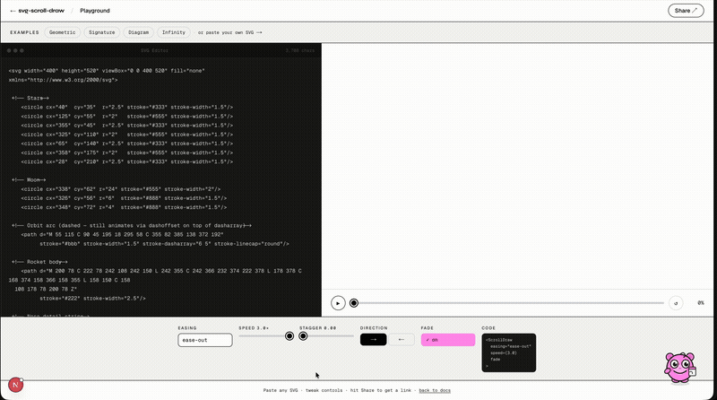

# svg-scroll-draw

[](https://github.com/DhruvilChauahan0210/ink-scroll/actions/workflows/ci.yml)
[](https://www.npmjs.com/package/svg-scroll-draw)
[](https://www.npmjs.com/package/svg-scroll-draw)
[](https://bundlephobia.com/package/svg-scroll-draw)
[](./LICENSE)
[](https://github.com/DhruvilChauahan0210/ink-scroll/stargazers)

> SVG line drawing on scroll, done right: correct path lengths, stagger across many paths, and `morphTo`. Where the browser supports `animation-timeline: view()` the draw runs on its own scroll timeline in CSS, with no per-frame JavaScript; in other browsers, and for options CSS can't express, a JavaScript engine draws it, and a parity suite checks in Chromium, Firefox and WebKit that both draw the same frame. **11.4 KB gzipped for every API, from 1.6 KB if you import one**, against 47.5 KB for GSAP + ScrollTrigger + DrawSVG. Zero dependencies, MIT.

**Switch in one line.** Already on AOS, ScrollReveal or vivus? Change the import and keep your markup and calls:

```diff
- import AOS from 'aos';
+ import AOS from 'svg-scroll-draw/aos';           // and delete aos.css: the styles ship inside
- import ScrollReveal from 'scrollreveal';
+ import ScrollReveal from 'svg-scroll-draw/scrollreveal';
- import Vivus from 'vivus';
+ import Vivus from 'svg-scroll-draw/vivus';
```

Each drop-in is tested side by side against the original in real browsers (AOS 2.3.4, which has had no release since; ScrollReveal 4.0.9, which is GPL-3.0 where this is MIT; vivus 0.4.6). `npx svg-scroll-draw migrate` makes the change across a project.

**And the rest of scroll animation.** Reveal, pin, snap, parallax, counters, video scrub and text splitting, each its own entry point, so you load only what you import. Works in React, Next.js, Vue, Svelte, Solid, Angular, Astro, Nuxt and vanilla JS. Plus [free in-browser tools](https://svg-scroll-draw.vercel.app/tools) — generators, editors and converters — that write the code for you.

**[Live Demo](https://svg-scroll-draw.vercel.app)** · [npm](https://www.npmjs.com/package/svg-scroll-draw) · [Docs](https://svg-scroll-draw.vercel.app/docs) · [Examples](https://svg-scroll-draw.vercel.app/examples) · [Report a bug](https://github.com/DhruvilChauahan0210/ink-scroll/issues)

**Guides by framework:** [React](https://svg-scroll-draw.vercel.app/react-scroll-animation) · [Next.js](https://svg-scroll-draw.vercel.app/nextjs-scroll-animation) · [Vue](https://svg-scroll-draw.vercel.app/vue-scroll-animation) · [Nuxt](https://svg-scroll-draw.vercel.app/nuxt-scroll-animation) · [Svelte](https://svg-scroll-draw.vercel.app/svelte-scroll-animation) · [Solid](https://svg-scroll-draw.vercel.app/solid-scroll-animation) · [Angular](https://svg-scroll-draw.vercel.app/angular-scroll-animation) · [Astro](https://svg-scroll-draw.vercel.app/astro-scroll-animation)

**Compared with:** [GSAP](https://svg-scroll-draw.vercel.app/vs-gsap) · [Framer Motion](https://svg-scroll-draw.vercel.app/vs-framer-motion) · [Motion](https://svg-scroll-draw.vercel.app/vs-motion) · [AOS](https://svg-scroll-draw.vercel.app/vs-aos) · [Locomotive Scroll](https://svg-scroll-draw.vercel.app/vs-locomotive-scroll) · [ScrollMagic](https://svg-scroll-draw.vercel.app/vs-scrollmagic) · [Vivus](https://svg-scroll-draw.vercel.app/vs-vivus)

**Try it in your browser, no install:** [Vanilla JS on StackBlitz](https://stackblitz.com/github/DhruvilChauahan0210/ink-scroll/tree/main/examples/vanilla) · [React on StackBlitz](https://stackblitz.com/github/DhruvilChauahan0210/ink-scroll/tree/main/examples/react)

**Using an AI coding agent?** Give it the [svg-scroll-draw skill](https://github.com/DhruvilChauahan0210/ink-scroll/blob/main/skills/svg-scroll-draw/SKILL.md) or point it at [llms.txt](https://svg-scroll-draw.vercel.app/llms.txt).



---

## What's in v2

| API | Import | What it does |
|---|---|---|
| `scrollAnimate` | `svg-scroll-draw` | Animate **any CSS property** on any element driven by scroll. Replaces `gsap.to + ScrollTrigger`. |
| `scrollCounter` | `svg-scroll-draw` | Animate a number from `from` to `to` as it scrolls into view. Custom format, decimals, easing. |
| `scrollParallax` | `svg-scroll-draw` | Move any element at a different rate than scroll. Speed multiplier, reverse direction. |
| `scrollDraw` | `svg-scroll-draw` | The original — scroll-driven SVG path drawing via `stroke-dashoffset`. |
| `scrollVideo` | `svg-scroll-draw/video` | Tie `<video>.currentTime` to scroll. The Apple/Stripe product-page pattern. |
| `scrollText` | `svg-scroll-draw/text` | Split text into chars/words/lines and stagger-animate each on scroll. 3.5 KB, nothing else to load. |
| `devtools` | `svg-scroll-draw/devtools` | Visual overlay showing every active animation's triggers and progress. Dev-only. |
| `AOS` | `svg-scroll-draw/aos` | Drop-in replacement for AOS: same `AOS.init()`, same `data-aos` markup, no `aos.css`. |
| `ScrollReveal` | `svg-scroll-draw/scrollreveal` | Drop-in replacement for ScrollReveal.js 4, MIT instead of GPL-3.0. |
| `Vivus` | `svg-scroll-draw/vivus` | Drop-in replacement for vivus 0.4: same `new Vivus()` API and output. |

All APIs return the same instance object: `{ destroy, replay, pause, resume, seek, getProgress }`.

Under `prefers-reduced-motion: reduce` each one shows its finished state instead of animating. If the reader turns the setting on while the page is open, everything still moving finishes at once, as if the page had loaded that way; turning it off again leaves it finished until the next load.

---

## Install

```bash
npm i svg-scroll-draw
# pnpm add svg-scroll-draw
# yarn add svg-scroll-draw
# bun add svg-scroll-draw
```

---

## scrollAnimate — any CSS property on scroll

```js
import { scrollAnimate } from 'svg-scroll-draw';

// Fade + slide in
scrollAnimate('#hero-text', {
  props: {
    opacity:   [0, 1],
    transform: ['translateY(40px)', 'translateY(0px)'],
  },
  easing: 'ease-out',
  once:   true,
});

// Color transition
scrollAnimate('#section', {
  props: {
    backgroundColor: ['#ffffff', '#0d0d0d'],
    color:           ['#000000', '#ffffff'],
  },
  trigger: { start: 'top 60%', end: 'top 20%' },
});

// Multiple elements with stagger
document.querySelectorAll('.card').forEach((el, i) => {
  scrollAnimate(el, {
    props: { opacity: [0, 1], transform: ['translateY(32px)', 'translateY(0)'] },
    trigger: { start: `top ${85 - i * 5}%`, end: `top ${50 - i * 5}%` },
    easing: 'ease-out',
    once:   true,
  });
});
```

#### React

```tsx
import { ScrollAnimate } from 'svg-scroll-draw/react';

<ScrollAnimate
  props={{ opacity: [0, 1], transform: ['translateY(24px)', 'translateY(0)'] }}
  easing="ease-out"
  once
>
  <div>Any content — HTML or SVG</div>
</ScrollAnimate>
```

#### scrollAnimate options

| Option | Type | Default | Description |
|---|---|---|---|
| `props` | `Record<string, [from, to]>` | — | CSS properties to animate. Supports numbers, hex/rgb colors, transform functions, and unit values like `40px`. |
| `trigger.start` | `string` | `"top bottom"` | When animation begins |
| `trigger.end` | `string` | `"bottom top"` | When animation ends |
| `easing` | `string \| fn` | `"ease-out"` | Same easing system as `scrollDraw` |
| `speed` | `number` | `1` | Animation scale factor |
| `once` | `boolean` | `false` | Freeze at max progress — doesn't reverse on scroll back |
| `axis` | `"x" \| "y"` | `"y"` | Scroll axis |
| `native` | `boolean` | `true` | Use CSS `animation-timeline: view()` fast path when eligible |
| `onProgress` | `(n: number) => void` | — | Called as the scroll moves, with alpha 0–1 (the first path’s, under `stagger`) |
| `onComplete` | `() => void` | — | Fires when alpha reaches 1 |

---

## scrollCounter — animated number on scroll

```js
import { scrollCounter } from 'svg-scroll-draw';

// Simple count-up
scrollCounter('#users', { to: 50_000, once: true });

// Formatted currency
scrollCounter('#revenue', {
  to:     1_250_000,
  format: n => '$' + Math.round(n).toLocaleString(),
  easing: 'ease-out',
  once:   true,
});

// Percentage with one decimal. decimals replaces format, so the % goes in format.
scrollCounter('#rate', {
  from:   0,
  to:     94.7,
  format: n => n.toFixed(1) + '%',
});
```

#### React

```tsx
import { ScrollCounter } from 'svg-scroll-draw/react';

<ScrollCounter to={50000} format={n => n.toLocaleString()} once />
```

#### scrollCounter options

| Option | Type | Default | Description |
|---|---|---|---|
| `to` | `number` | — | Target value **(required)** |
| `from` | `number` | `0` | Starting value. Set higher than `to` to count down. |
| `format` | `(n: number) => string` | `String(Math.round(n))` | Custom formatter |
| `decimals` | `number` | — | Shorthand for `format: n => n.toFixed(decimals)`; replaces `format` when both are set |
| `easing` | `string \| fn` | `"ease-out"` | — |
| `trigger` | `TriggerConfig` | `{ start: 'top 80%', end: 'top 20%' }` | — |
| `once` | `boolean` | `true` | — |
| `onComplete` | `() => void` | — | — |

---

## scrollParallax — parallax in one line

```js
import { scrollParallax } from 'svg-scroll-draw';

scrollParallax('#hero-bg', { speed: 0.4 });           // up 40% of its height: ahead of the page
scrollParallax('#floating-badge', { speed: -0.3 });   // down 30%: lags behind the page
scrollParallax('#sidebar', { speed: 0.3, axis: 'x' }); // horizontal
```

`speed` is how far the element travels while it crosses the viewport, as a fraction of its own height (its width on `axis: 'x'`). A positive speed moves it up as you scroll down, so it runs ahead of the page: `0.5` = up half its height. A negative one moves it down, so it lags behind, as a background does: `-0.2` = down a fifth.

---

## scrollVideo — video scrubbing on scroll

```js
import { scrollVideo } from 'svg-scroll-draw/video';

// Scrub the full video as user scrolls through the section
scrollVideo('#hero-video', {
  trigger: { start: 'top top', end: 'bottom top' },
});

// Scrub only the first 3 seconds
scrollVideo('#product-reveal', {
  from:    0,
  to:      3,
  trigger: { start: 'top 80%', end: 'top 20%' },
  easing:  'ease-in-out',
});
```

```html
<!-- Recommended attributes for smooth scrubbing -->
<video id="hero-video" src="hero.mp4" muted playsinline preload="auto"></video>
```

#### React

```tsx
import { ScrollVideo } from 'svg-scroll-draw/react';

<ScrollVideo src="/hero.mp4" poster="/hero.jpg" trigger={{ start: 'top top', end: 'bottom top' }} />
```

#### scrollVideo options

| Option | Type | Default | Description |
|---|---|---|---|
| `from` | `number` | `0` | Start time in seconds |
| `to` | `number` | `video.duration` | End time in seconds |
| `trigger` | `TriggerConfig` | `{ start: 'top top', end: 'bottom top' }` | — |
| `easing` | `string \| fn` | `"linear"` | — |
| `once` | `boolean` | `false` | — |
| `preload` | `"auto" \| "metadata"` | `"auto"` | Sets `preload` attribute if not already present. The React `<ScrollVideo>` renders it from this option (2.23.4), and passes `poster` through to the `<video>` |
| `triggerElement` | `Element` | the video | Measure the trigger window from this element — the tall track behind a `position: sticky` stage, so a pinned film scrubs the length of the pin (2.18.0) |
| `onReady` | `() => void` | — | Fires when video metadata is loaded |
| `onProgress` | `(n: number) => void` | — | — |
| `onComplete` | `() => void` | — | — |

---

## scrollText — text reveal on scroll

A 3.5 KB alternative to GSAP SplitText. SplitText is free and 3.6 KB, but it only splits — animating the pieces needs GSAP core (27.7 KB) on top.

```js
import { scrollText } from 'svg-scroll-draw/text';

// Words fade up one by one
scrollText('#headline', {
  split:   'words',
  stagger: 0.05,
  from:    { opacity: 0, y: 24 },
  easing:  'ease-out',
  once:    true,
});

// Characters with rotation
scrollText('#tagline', {
  split:   'chars',
  stagger: 0.025,
  from:    { opacity: 0, y: 32, rotate: 8 },
  once:    true,
});
```

#### React

```tsx
import { ScrollText } from 'svg-scroll-draw/react';

<ScrollText split="words" stagger={0.05} from={{ opacity: 0, y: 24 }} once>
  Animate this headline word by word.
</ScrollText>
```

#### scrollText options

| Option | Type | Default | Description |
|---|---|---|---|
| `split` | `"chars" \| "words" \| "lines"` | `"words"` | How to split the text |
| `stagger` | `number` | `0.04` | Delay between each unit (0–1 fraction of the animation range) |
| `from` | `{ opacity?, y?, x?, rotate?, scale? }` | `{ opacity: 0, y: 24 }` | Starting state of each unit |
| `easing` | `string \| fn` | `"ease-out"` | — |
| `trigger` | `TriggerConfig` | `{ start: 'top 85%', end: 'top 40%' }` | — |
| `once` | `boolean` | `true` | — |
| `onComplete` | `() => void` | — | — |

> **Accessibility:** `scrollText` adds `aria-hidden="true"` to every split piece and keeps the whole text once in a visually hidden span, which a screen reader reads as part of the element (ARIA does not allow an `aria-label` on a `<p>`, `<span>` or `<div>`). `destroy()` fully restores the original HTML.

---

## scrollDraw — SVG path drawing (v1 API, unchanged)

```js
import { scrollDraw } from 'svg-scroll-draw';

scrollDraw('#my-svg', {
  easing:    'ease-out',
  speed:     1.2,
  fade:      true,
  once:      true,
  stagger:   0.15,
  trigger:   { start: 'top 80%', end: 'top 20%' },
});
```

#### React / Next.js

```tsx
import { ScrollDraw } from 'svg-scroll-draw/react';

export default function Hero() {
  return (
    <ScrollDraw speed={1.2} fade easing="ease-out" once>
      <svg width="500" height="500" viewBox="0 0 500 500">
        <path d="M10 80 C 40 10, 60 10, 95 80" stroke="black" fill="none" />
      </svg>
    </ScrollDraw>
  );
}
```

> **Next.js App Router:** `svg-scroll-draw/react` is marked `"use client"` (from 2.16.1), so a Server
> Component can render these components directly. Options that are functions, such as `onProgress`,
> cannot cross from server to client: put those in a `'use client'` component of your own.

#### Vue 3

```vue
<script setup>
import { ScrollDraw } from 'svg-scroll-draw/vue';
</script>

<template>
  <ScrollDraw easing="ease-out" :speed="1.2">
    <svg>...</svg>
  </ScrollDraw>
</template>
```

> **Options are live** (from 2.17.0): React and Vue component props, Vue composable options passed as
> a getter or ref, Solid options passed as an accessor, Svelte action parameters and Angular's
> `update()` from `ngOnChanges` all rebuild the animation when an option really changes. Equal
> options — an inline object recreated each render, a new callback — keep the running one.

#### scrollDraw options

| Option | Type | Default | Description |
|---|---|---|---|
| `selector` | `string` | `"path, polyline…"` | CSS selector for child elements to animate |
| `speed` | `number` | `1` | Scale factor relative to scroll distance |
| `fade` | `boolean` | `false` | Animate `opacity 0 → 1` simultaneously |
| `easing` | `string \| fn` | `"linear"` | `linear`, `ease-in`, `ease-out`, `ease-in-out`, `spring`, `bounce`, `elastic`, or `(t) => t` |
| `stagger` | `number` | `0` | Offset between each path starting (fraction of scroll range). The last path ends that much after `trigger.end`; where the page ends first, the stagger tightens so it finishes at the bottom |
| `direction` | `"forward" \| "reverse"` | `"forward"` | `reverse` erases the path as you scroll |
| `trigger.start` | `string` | `"top bottom"` | When animation begins |
| `trigger.end` | `string` | `"bottom top"` | When animation ends |
| `once` | `boolean` | `false` | Lock at max progress |
| `debug` | `boolean` | `false` | Show trigger zone overlay (dev only) |
| `axis` | `"x" \| "y"` | `"y"` | Scroll axis |
| `scrollContainer` | `string \| Element` | `window` | Custom scroll container |
| `autoReverse` | `boolean` | `false` | Reverse when scrolling back up |
| `delay` | `number` | `0` | ms before the engine starts observing |
| `strokeColor` | `string \| [string, string]` | — | Static color or `[from, to]` animation |
| `strokeWidth` | `number \| [number, number]` | — | Static width or `[from, to]` animation |
| `fillOpacity` | `number \| [number, number]` | — | Animate fill opacity in sync with the draw |
| `clip` | `boolean \| "left" \| "right" \| "top" \| "bottom" \| "center"` | `false` | Reveal via CSS `clip-path` instead of stroke-dashoffset |
| `morphTo` | `string` | — | SVG path `d` value to morph toward |
| `waypoints` | `Record<number, () => void>` | — | Callbacks at specific progress thresholds (0–1) |
| `velocityScale` | `boolean \| number` | `false` | Scale draw speed by scroll velocity |
| `repeat` | `number \| "infinite"` | `0` | Replay N times after completion |
| `repeatDelay` | `number` | `0` | ms between repeats |
| `autoplay` | `boolean` | `false` | Trigger on viewport entry instead of scroll |
| `duration` | `number` | `1000` | Duration in ms for `autoplay` mode |
| `native` | `boolean` | `true` | Use CSS `animation-timeline: view()` when eligible |
| `preset` | `"sketch" \| "reveal" \| "typewriter" \| "cinematic" \| "spring"` | — | Apply a named option preset as the base config |
| `onProgress` | `(alpha: number) => void` | — | Called as the scroll moves, with draw progress (0–1); under `stagger`, the first path’s, as `getProgress()` |
| `onStart` | `() => void` | — | Fires on the first frame |
| `onComplete` | `() => void` | — | Fires when all paths reach 100% |

---

## AOS drop-in — switch from AOS in one line

Already using [AOS](https://github.com/michalsnik/aos)? `svg-scroll-draw/aos` speaks its API and
reads its markup, so the move is an import change — or one command: `npx svg-scroll-draw migrate`. Keep every `data-aos`, `data-aos-offset`,
`data-aos-delay`, `data-aos-anchor-placement` and custom animation; delete `aos.css` — the styles ship
inside the module. 3.2 KB gzipped with the styles, against 6.7 KB for AOS 2.3.4 with its stylesheet.

```diff
- import AOS from 'aos';
- import 'aos/dist/aos.css';
+ import AOS from 'svg-scroll-draw/aos';

  AOS.init({ once: true });
```

[Try it on StackBlitz](https://stackblitz.com/github/DhruvilChauahan0210/ink-scroll/tree/main/examples/aos) — a page written for the original library, with only the import changed.

No bundler? Swap the script tag, and drop the stylesheet link:

```html
<script src="https://unpkg.com/svg-scroll-draw/dist/cdn/aos.global.js"></script>
<script>AOS.init();</script>
```

Step-by-step guides: [AOS in Next.js](https://svg-scroll-draw.vercel.app/guides/aos-nextjs) · [AOS in React](https://svg-scroll-draw.vercel.app/guides/aos-react).

**React and Next.js.** `svg-scroll-draw/aos/react` owns the lifecycle AOS never had: it initialises on mount,
destroys on unmount (so StrictMode's double mount is safe), and new `[data-aos]` content from a route change is
picked up automatically. The file is marked `"use client"`, so it drops straight into an App Router layout:

```tsx
// app/layout.tsx — a Server Component
import { AOSInit } from 'svg-scroll-draw/aos/react';

export default function RootLayout({ children }) {
  return <html lang="en"><body><AOSInit once duration={600} />{children}</body></html>;
}
```

Or call `useAOS(options, refreshKey)` in any client component; changing `refreshKey` (say, the pathname)
re-measures positions.

`init`, `refresh` and `refreshHard` behave as in AOS 2.3.4: the same trigger positions (anchor
placements, `data-aos-anchor`, offsets — including AOS's rule that an inline anchor placement without an
inline offset uses 0), the same `aos-init` / `aos-animate` classes, the same transforms and end states.
The browser suite runs AOS 2.3.4 and the drop-in side by side on one page in Chromium, Firefox and
WebKit and fails if any element differs at any scroll stop. AOS 3's `mirror`, `anchorPlacement`,
`initClassName`, `animatedClassName`, `useClassNames` and the `aos:in` / `aos:out` events work too.

Differences, on purpose:

- `prefers-reduced-motion: reduce` shows every element in its final state, with no transition, also when the reader turns it on while the page is open.
- `disable: 'phone' | 'tablet' | 'mobile'` checks the viewport width, not the user agent.
- Trigger positions are re-measured on `load`, so images that finish late do not shift them.
- `AOS.destroy()` stops everything, for single-page apps that unmount the page.
- `throttleDelay` / `debounceDelay` are accepted and ignored: scroll work is batched per frame.

---

## ScrollReveal drop-in — MIT instead of GPL

On [ScrollReveal](https://scrollrevealjs.org)? It is GPL-3.0 (with a paid licence for commercial work)
and has not shipped since 4.0.9. `svg-scroll-draw/scrollreveal` is an independent, MIT-licensed
implementation of the same API, so the move is an import change — or one command: `npx svg-scroll-draw migrate`.
4.7 KB gzipped, against 5.6 KB.

```diff
- import ScrollReveal from 'scrollreveal';
+ import ScrollReveal from 'svg-scroll-draw/scrollreveal';

  ScrollReveal({ distance: '40px', duration: 800 }).reveal('.card', { interval: 80 });
```

[Try it on StackBlitz](https://stackblitz.com/github/DhruvilChauahan0210/ink-scroll/tree/main/examples/scrollreveal) — a page written for the original library, with only the import changed.

No bundler? `<script src="https://unpkg.com/svg-scroll-draw/dist/cdn/scrollreveal.global.js"></script>`
defines `window.ScrollReveal` as the function, like ScrollReveal's own file. With CommonJS,
`require('svg-scroll-draw/scrollreveal').default` is the function.

Step-by-step guide: [ScrollReveal in React and Next.js](https://svg-scroll-draw.vercel.app/guides/scrollreveal-react).

**React and Next.js.** `useScrollReveal()` from `svg-scroll-draw/scrollreveal/react` reveals the element its
ref is on — or its children matching `selector`, for `interval` sequences — and cleans up on unmount, so
components that mount later (a route change, a list that loads) are revealed too:

```tsx
'use client';
import { useScrollReveal } from 'svg-scroll-draw/scrollreveal/react';

export function Cards() {
  const ref = useScrollReveal({ selector: '.card', interval: 80, distance: '30px' });
  return <div ref={ref}>{/* .card children */}</div>;
}
```

Every option behaves as in 4.0.9 — `distance` / `origin`, `opacity`, `scale`, `rotate`, `duration`,
`delay`, `easing`, `interval` sequences, `reset`, `useDelay`, `viewFactor`, `viewOffset`,
`container`, `mobile` / `desktop`, `cleanup` and the four callbacks — as do `reveal`, `clean`, `sync`,
`destroy`, `data-sr-id` and the `sr` class on `<html>` for FOUC-hiding CSS. The browser suite runs
ScrollReveal 4.0.9 beside it in Chromium, Firefox and WebKit and fails if any element's inline `style`
differs by a character at any scroll stop, or if any callback fires differently.

Differences, on purpose:

- Nothing happens on import. ScrollReveal adds the `sr` class and `body { height: 100% }` as soon as its
  script loads; this does both on the first `ScrollReveal()` call, keeping the import SSR-safe.
- `prefers-reduced-motion: reduce` shows every element in its final state, with no transition, also when the reader turns it on while the page is open.

---

## vivus drop-in — keep your `new Vivus()` code

On [vivus](https://github.com/maxwellito/vivus)? It has not shipped since 0.4.6 (April 2021).
`svg-scroll-draw/vivus` runs the same API, so the move is an import change — or one command:
`npx svg-scroll-draw migrate`. 4.0 KB gzipped, against 4.1 KB.

```diff
- import Vivus from 'vivus';
+ import Vivus from 'svg-scroll-draw/vivus';

  new Vivus('my-svg', { type: 'oneByOne', duration: 200 }, () => console.log('drawn'));
```

[Try it on StackBlitz](https://stackblitz.com/github/DhruvilChauahan0210/ink-scroll/tree/main/examples/vivus) — a page written for the original library, with only the import changed.

No bundler? `<script src="https://unpkg.com/svg-scroll-draw/dist/cdn/vivus.global.js"></script>`
defines `window.Vivus`. With CommonJS, `require('svg-scroll-draw/vivus').default` is the class.

Step-by-step guide: [vivus in React](https://svg-scroll-draw.vercel.app/guides/vivus-react).

**React and Next.js.** `useVivus()` from `svg-scroll-draw/vivus/react` creates the instance on the mounted
`<svg>`, destroys it on unmount, and hands it back for `play()`, `reset()` and the rest:

```tsx
'use client';
import { useVivus } from 'svg-scroll-draw/vivus/react';

export function Logo() {
  const [ref, vivus] = useVivus<SVGSVGElement>({ type: 'oneByOne', duration: 120 });
  return <svg ref={ref} onClick={() => vivus?.reset().play()}>{/* paths */}</svg>;
}
```

Every option, every animation type (`delayed`, `sync`, `async`, `nsync`, `oneByOne`, `scenario`,
`scenario-sync`), the `start` modes, `file` and `<object>` loading, the `data-start` / `data-duration` /
`data-delay` / `data-async` / `data-ignore` attributes, `Vivus.EASE` and the other timing functions, and
`play` / `stop` / `reset` / `finish` / `setFrameProgress` / `getStatus` / `destroy` / `recalc` behave as
in 0.4.6. Shapes become `<path>`s with the same `d` strings, and dashes get the same values: the browser
suite runs vivus 0.4.6 beside it across nine configurations and requires the SVG markup to match exactly
at every point of the animation. Like vivus, the clock is the animation frame.

One difference, on purpose: under `prefers-reduced-motion: reduce` (including when it is turned on mid-play), `play()` jumps to the end and still
fires its callbacks. When you want the stroke to follow the scroll instead of a clock, use
[`scrollDraw`](#scrolldraw--svg-path-drawing-v1-api-unchanged) from the same package.

---

## Instance API

Every function returns the same instance object:

```ts
const inst = scrollAnimate('#el', { props: { opacity: [0, 1] } });
// Same for scrollDraw, scrollCounter, scrollVideo, scrollText, scrollParallax

inst.pause();           // pause at current frame
inst.resume();          // resume from paused state
inst.seek(0.5);         // jump to 50% and pause
inst.replay();          // reset and replay from the beginning
inst.getProgress();     // → number 0–1
inst.destroy();         // remove all listeners and clean up
```

---

## Easing

All APIs share the same easing system:

```js
// Named strings
easing: 'linear' | 'ease-in' | 'ease-out' | 'ease-in-out' | 'spring' | 'bounce' | 'elastic'

// Custom function
easing: (t: number) => number

// Factory functions for parameterized physics easings
import { createSpring, createBounce, createElastic } from 'svg-scroll-draw';

easing: createSpring({ tension: 3, friction: 1.8 })
easing: createBounce({ bounces: 4, decay: 0.4 })
easing: createElastic({ amplitude: 1.5, period: 0.3 })
```

---

## Presets

Named option bags for `scrollDraw`:

```js
import { scrollDraw, PRESETS } from 'svg-scroll-draw';

scrollDraw('#logo', { preset: 'sketch' });    // staggered ease-in, pencil feel
scrollDraw('#hero', { preset: 'reveal' });    // fade + ease-out, once
scrollDraw('#type', { preset: 'typewriter' }); // fast linear stagger
scrollDraw('#film', { preset: 'cinematic' }); // slow ease-in-out + fade
scrollDraw('#icon', { preset: 'spring' });    // spring easing

// Inspect or extend
console.log(PRESETS.sketch);
```

---

## DevTools

Visual debug overlay — shows every active animation's trigger window, progress bar, and type. Zero production bytes.

```js
import { devtools } from 'svg-scroll-draw/devtools';

devtools.enable();    // Cmd/Ctrl+Shift+S to toggle
devtools.disable();
devtools.highlight('#my-element'); // outline for 2 seconds
```

---

## Sub-path exports

| Import | Contents |
|---|---|
| `svg-scroll-draw` | `scrollDraw`, `scrollAnimate`, `scrollCounter`, `scrollParallax`, `PRESETS`, easing factories |
| `svg-scroll-draw/react` | `ScrollDraw`, `ScrollAnimate`, `ScrollCounter`, `ScrollVideo`, `ScrollText`, `useScrollDrawProgress` |
| `svg-scroll-draw/vue` | `ScrollDraw`, `useScrollDraw` · **v2:** `ScrollAnimate`, `ScrollCounter`, `ScrollVideo`, `ScrollText`, `useScrollAnimate`, `useScrollCounter`, `useScrollVideo`, `useScrollText` |
| `svg-scroll-draw/svelte` | `scrollDraw` action, `createScrollDraw` · **v2:** `scrollAnimate`, `scrollCounterAction`, `scrollVideoAction`, `scrollTextAction`, `createScrollAnimate`, `createScrollCounter`, `createScrollVideo`, `createScrollText` |
| `svg-scroll-draw/solid` | `useScrollDraw`, `createScrollDraw` · **v2:** `useScrollAnimate`, `useScrollCounter`, `useScrollVideo`, `useScrollText`, `createScrollAnimate`, `createScrollCounter`, `createScrollVideo`, `createScrollText` |
| `svg-scroll-draw/angular` | `ScrollDrawRef` · **v2:** `ScrollAnimateRef`, `ScrollCounterRef`, `ScrollVideoRef`, `ScrollTextRef` |
| `svg-scroll-draw/astro` | `initScrollDraw()` · **v2:** `initScrollAnimate()`, `initScrollCounter()`, `initScrollText()`, `initAll()` |
| `svg-scroll-draw/nuxt` | All Vue v1+v2 composables and components, `createScrollDrawPlugin()` |
| `svg-scroll-draw/video` | `scrollVideo` |
| `svg-scroll-draw/text` | `scrollText` |
| `svg-scroll-draw/group` | `scrollDrawGroup`, `scrollDrawSequence` · **v2:** `scrollAnimateGroup`, `scrollAnimateSequence`, `scrollParallaxGroup` |
| `svg-scroll-draw/timeline` | `scrollDrawTimeline` |
| `svg-scroll-draw/cinematic` | `Cinematic` |
| `svg-scroll-draw/devtools` | `devtools` (dev-only) |
| `svg-scroll-draw/aos` | `AOS` (default), `init`, `refresh`, `refreshHard`, `destroy` |
| `svg-scroll-draw/scrollreveal` | `ScrollReveal` (default and named) |
| `svg-scroll-draw/vivus` | `Vivus` (default and named) |
| `svg-scroll-draw/aos/react` | `useAOS`, `AOSInit` (`"use client"`) |
| `svg-scroll-draw/scrollreveal/react` | `useScrollReveal` (`"use client"`) |
| `svg-scroll-draw/vivus/react` | `useVivus` (`"use client"`) |

---

## Bundle sizes

<!-- size-table:start -->
| Entry | Gzipped |
|---|---|
| `svg-scroll-draw` (main, every core API) | 11.4 KB |
| `svg-scroll-draw/react` (includes the engine) | 12.8 KB |
| `svg-scroll-draw` + `svg-scroll-draw/react` (together; the engine ships once) | 14.3 KB |
| `svg-scroll-draw/reveal` | 5.7 KB |
| `svg-scroll-draw/text` | 3.5 KB |
| `svg-scroll-draw/video` | 2.9 KB |
| `svg-scroll-draw/scrollreveal` | 4.7 KB |
| `svg-scroll-draw/vivus` | 4.2 KB |
| `svg-scroll-draw/aos` (styles included) | 3.2 KB |
| `svg-scroll-draw/snap` | 2.0 KB |
| `svg-scroll-draw/devtools` | 1.8 KB (dev only) |
| `svg-scroll-draw/pin` | 1.6 KB |
<!-- size-table:end -->

Measured with `npm run size`: each entry plus the shared chunks it imports, minified, gzip level 9. Entries share their code through those chunks, so importing several costs less than the sum. For comparison, GSAP 3.15.0 core + ScrollTrigger is 45.3 KB gzipped, and 47.5 KB with DrawSVG. GSAP does far more than scroll animation; for the scroll effects this library covers, that is the size difference.

---

## CDN / Web Component

```html
<script src="https://unpkg.com/svg-scroll-draw/dist/cdn/svg-scroll-draw.global.js"></script>

<scroll-draw easing="ease-out" speed="1.2">
  <svg>...</svg>
</scroll-draw>

<script>
  SvgScrollDraw.scrollDraw('#container', { easing: 'ease-out' });
  SvgScrollDraw.scrollAnimate('#hero', {
    props: { opacity: [0, 1] }, easing: 'ease-out', once: true,
  });
</script>
```

---

## CLI

```bash
npx svg-scroll-draw init
```

Scaffolds a ready-to-use starter file for React, Vue, Svelte, Solid, or Vanilla JS.

### Switching from AOS, ScrollReveal or vivus

```bash
npx svg-scroll-draw migrate --dry-run   # see what would change
npx svg-scroll-draw migrate             # apply it
```

Points every `import` / `require` of `aos`, `scrollreveal` and `vivus` at the matching drop-in, swaps CDN
`<script>` tags for the script-tag builds (dropping any stale `integrity` hash), removes AOS's `aos.css`
imports, `<link>`s and `@import`s, and swaps the dependency in `package.json`. It rewrites module names,
URLs and dependency entries only — never the code that uses them — skips `node_modules` and build output,
and will not write over uncommitted git changes unless you pass `--force`.

---

## Browser support

Chrome 80+, Safari 14+, Firefox 75+, Edge 80+

Native CSS `animation-timeline: view()` fast path: Chrome and Edge 115+, Safari 26+, Firefox 159+ (on by default since October 2026). Older browsers fall back to the JS engine automatically.

---

## License

MIT
